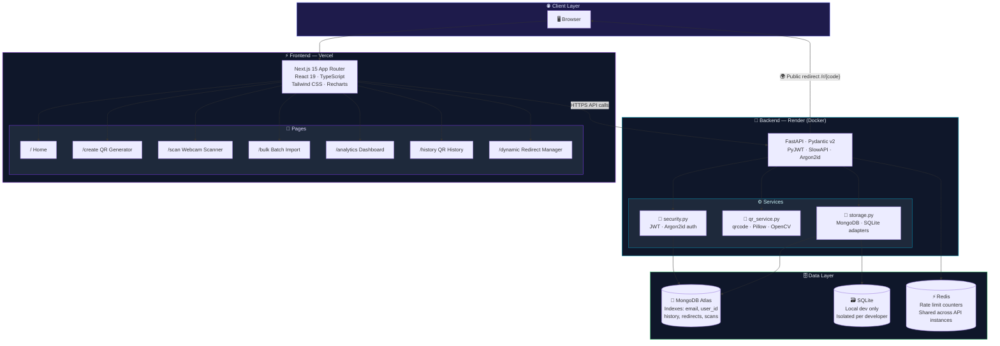
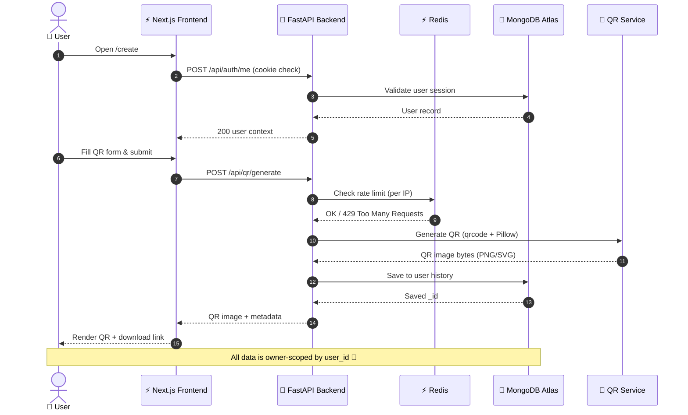
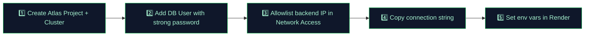
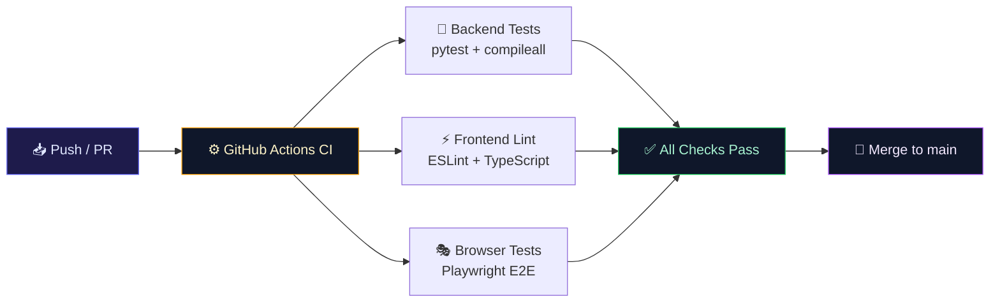

<div align="center">

<!-- Animated Banner -->


<!-- Badges Row 1 -->
<p align="center">
  
  
  
  
  
</p>

<!-- Badges Row 2 -->
<p align="center">
  
  
  
  
  
</p>

<!-- Badges Row 3 -->
<p align="center">
  
  
  
  
</p>

<br/>

> ### 🚀 *The ultimate enterprise-grade QR Code platform — generate, scan, analyze, and manage QR codes at scale with bulletproof security and beautiful UX.*

<br/>

</div>

---

## 📌 Table of Contents

<div align="center">

| 🔗 Section | 📄 Description |
|:----------:|:--------------|
| [✨ Features](#-features) | Full feature overview |
| [🏗️ Architecture](#️-system-architecture) | System design & flow |
| [📁 Project Structure](#-project-structure) | Directory layout |
| [⚡ Tech Stack](#-tech-stack) | Technologies used |
| [🛠️ Local Setup](#️-local-development-setup) | Dev environment guide |
| [☁️ Deployment](#️-deployment) | Cloud deployment steps |
| [🔐 Security](#-security-model) | Security controls |
| [📡 API Reference](#-api-reference) | All API endpoints |
| [📊 Analytics](#-analytics--monitoring) | Metrics & monitoring |
| [🚧 Release Gates](#-release-gates) | Pre-launch checklist |

</div>

---

## ✨ Features

<div align="center">

```
╔══════════════════════════════════════════════════════════════════════════════════╗
║                    🎯  QR CODE STUDIO — ENTERPRISE CAPABILITIES                 ║
╠══════════════════╦═══════════════════════╦═══════════════════════════════════════╣
║  👤 AUTH & IAM   ║   📊 ANALYTICS        ║   🔲 QR WORKFLOWS                    ║
╠══════════════════╬═══════════════════════╬═══════════════════════════════════════╣
║ Email + Password ║ Per-account metrics   ║ URL, Text, Wi-Fi, vCard               ║
║ JWT (12h, HttpOnly)║ Daily scan activity ║ Email, Phone QR types                 ║
║ Argon2id hashing ║ QR type breakdown    ║ Color & logo customization             ║
║ Owner-scoped data║ Dynamic scan events  ║ PNG / SVG export                       ║
║ Role: user/admin ║ Recharts visualizer  ║ CSV / XLSX bulk import (500 rows)      ║
║ Secure cookies   ║ Favorites tracking   ║ ZIP batch download                     ║
╠══════════════════╬═══════════════════════╬═══════════════════════════════════════╣
║  🔒 SECURITY     ║   🌐 DYNAMIC QR       ║   📷 SCANNING                         ║
╠══════════════════╬═══════════════════════╬═══════════════════════════════════════╣
║ Rate limiting    ║ Redirect creation     ║ OpenCV image decoding                 ║
║ CORS allowlist   ║ Destination updates  ║ Webcam live scanner                   ║
║ Origin checks    ║ Unguessable codes    ║ html5-qrcode integration              ║
║ Security headers ║ Scan event tracking  ║ File upload scanning                  ║
║ Request limits   ║ Ownership gating     ║ Browser permission aware              ║
╚══════════════════╩═══════════════════════╩═══════════════════════════════════════╝
```

</div>

---

## 🏗️ System Architecture



---

## 🔗 Request Flow



---

## 📁 Project Structure

```
🏠 qr-code-studio-enterprise/
└── 📦 qr-code-studio-web/
    ├── 🔧 backend/
    │   ├── 📂 app/
    │   │   ├── 🐍 main.py              ← All FastAPI routes & middleware
    │   │   ├── 🔐 security.py          ← JWT creation/validation, Argon2id
    │   │   └── ⚙️  services/
    │   │       ├── 🔲 qr_service.py   ← QR generation (qrcode + Pillow + OpenCV)
    │   │       └── 💾 storage.py      ← MongoDB Atlas / SQLite adapters
    │   ├── 🧪 tests/
    │   │   └── pytest + FastAPI TestClient
    │   ├── 🐳 Dockerfile
    │   ├── 📄 requirements.txt
    │   └── 📄 requirements-dev.txt
    │
    ├── ⚡ frontend/
    │   ├── 📂 app/
    │   │   ├── 🏠 page.tsx            ← Landing page
    │   │   ├── 🔲 create/             ← QR Generator page
    │   │   ├── 📷 scan/               ← Webcam + upload scanner
    │   │   ├── 📦 bulk/               ← CSV / XLSX batch import
    │   │   ├── 📊 analytics/          ← Recharts dashboard
    │   │   ├── 📜 history/            ← QR history & favorites
    │   │   ├── 🌐 dynamic/            ← Dynamic redirect manager
    │   │   ├── 🔑 login/              ← Auth page
    │   │   └── 📝 register/           ← Account creation
    │   ├── 🧩 components/
    │   │   └── shell.tsx              ← App shell (nav + layout wrapper)
    │   ├── 📚 lib/                    ← Shared utilities & API client
    │   ├── 🎭 e2e/                    ← Playwright smoke tests
    │   └── 📄 package.json
    │
    ├── ⚙️  .github/workflows/ci.yml   ← Backend tests + lint + Playwright CI
    └── 📋 render.yaml                 ← Render blueprint (Docker API service)
```

---

## ⚡ Tech Stack

<div align="center">

### 🖥️ Frontend

| Technology | Version | Purpose |
|:----------:|:-------:|:--------|
|  | **15** | App Router, SSR, file-based routing |
|  | **19** | UI component library |
|  | **5.7** | Type safety throughout |
|  | **3.4** | Utility-first CSS framework |
|  | **2.15** | Analytics data visualization |
|  | **0.468** | Icon system |
|  | **2.3** | Webcam live QR scanning |

### 🔧 Backend

| Technology | Version | Purpose |
|:----------:|:-------:|:--------|
|  | **0.115** | Async API framework |
|  | **3.11+** | Backend runtime |
|  | **v2** | Request/response validation |
| `PyJWT` | latest | JWT session tokens |
| `Argon2id` | latest | Password hashing (OWASP recommended) |
| `SlowAPI` | latest | Rate limiting middleware |
| `qrcode` + `Pillow` | latest | QR image generation |
| `OpenCV` | latest | QR image decoding |
| `openpyxl` | latest | XLSX spreadsheet parsing |

### 🗄️ Data & Infrastructure

| Service | Role | Environment |
|:-------:|:----:|:-----------:|
| 🍃 **MongoDB Atlas** | Primary database | Production |
| ⚡ **Redis** | Rate-limit counter store | Production |
| 🗃️ **SQLite** | Isolated dev database | Local dev only |
| 🐳 **Docker** | Backend containerization | All environments |
| ▲ **Vercel** | Frontend CDN + hosting | Production |
| 🔷 **Render** | Backend PaaS (Docker) | Production |

</div>

---

## 🛠️ Local Development Setup

> **Prerequisites:** Python 3.11+, Node.js 18+, npm

### 🔧 Step 1 — Backend Setup

```powershell
# Navigate to backend
cd backend

# Create & activate virtual environment
py -m venv .venv
.\.venv\Scripts\Activate.ps1

# Install dependencies
python -m pip install --upgrade pip
python -m pip install -r requirements-dev.txt

# Copy environment file
Copy-Item .env.example .env
```

Generate a cryptographically strong JWT secret:

```powershell
python -c "import secrets; print(secrets.token_urlsafe(48))"
```

Paste the output into `backend/.env` as `JWT_SECRET`:

```env
# backend/.env (local development)
APP_ENV=development
JWT_SECRET=<paste-generated-secret-here>

# Optional: use MongoDB Atlas even locally
# MONGODB_URI=mongodb+srv://<user>:<pass>@<cluster>/
# MONGODB_DATABASE=qr_code_studio

# Leave blank for local dev (uses SQLite + in-memory rate limits)
REDIS_URL=
```

Start the API server:

```powershell
uvicorn app.main:app --reload --port 8000
```

| Endpoint | URL |
|:--------:|:---:|
| 🔧 **API Base** | http://localhost:8000 |
| 📖 **Swagger UI** | http://localhost:8000/docs |
| 🔍 **ReDoc** | http://localhost:8000/redoc |
| ❤️ **Health Check** | http://localhost:8000/api/health |

---

### ⚡ Step 2 — Frontend Setup

```powershell
# In a NEW terminal, navigate to frontend
cd frontend

# Install dependencies
npm install

# Copy environment file
Copy-Item .env.local.example .env.local
```

```env
# frontend/.env.local
NEXT_PUBLIC_API_URL=http://localhost:8000
```

Start the dev server:

```powershell
npm run dev
```

🌐 Open **http://localhost:3000** in your browser.  
📝 Register at `/register` → all workspace routes require a valid session.

---

### 📷 Step 3 — Webcam Scanner

> Webcam access requires camera permission **and** a secure context.
> 
> - ✅ `http://localhost` → allowed for local dev  
> - ✅ `https://` → required for production  
> - ❌ `http://` on non-localhost → will not work

---

## ☁️ Deployment

### 🍃 MongoDB Atlas Configuration



Production environment variables:

```env
# backend — Render environment
APP_ENV=production
JWT_SECRET=<long-random-secret-min-48-chars>
MONGODB_URI=mongodb+srv://<db-user>:<password>@<cluster-host>/
MONGODB_DATABASE=qr_code_studio
REDIS_URL=rediss://<managed-redis-tls-url>
FRONTEND_ORIGIN=https://app.yourdomain.com
PUBLIC_BASE_URL=https://api.yourdomain.com
```

---

### 🔷 Backend — Render (Docker)

| Step | Action |
|:----:|:-------|
| **1** | Push repository to GitHub |
| **2** | Create Render Blueprint from repo (`render.yaml` auto-configures the Docker service) |
| **3** | Add secret env vars in Render dashboard |
| **4** | Use managed Redis with TLS (`rediss://`) |
| **5** | Enable MongoDB Atlas backups on your cluster |
| **6** | Verify: `GET https://api.yourdomain.com/api/health` → `{"database": "mongodb"}` |

---

### ▲ Frontend — Vercel

| Step | Action |
|:----:|:-------|
| **1** | Import GitHub repository into Vercel |
| **2** | Set **Root Directory** → `frontend` |
| **3** | Add env var: `NEXT_PUBLIC_API_URL=https://api.yourdomain.com` |
| **4** | Deploy & configure custom domain |

> 💡 **Pro Tip:** Use the same registrable domain for frontend + API (e.g., `app.example.com` and `api.example.com`) to ensure reliable cross-origin cookie behavior. **Never** use wildcard CORS with credentials.

---

## 🔐 Security Model

```
┌─────────────────────────────────────────────────────────────────────────┐
│                      🛡️  DEFENSE IN DEPTH                               │
├─────────────────┬──────────────────────────────────────────────────────┤
│  Layer          │  Controls                                             │
├─────────────────┼──────────────────────────────────────────────────────┤
│ 🔑 AuthN        │ Argon2id password hashing (OWASP P1)                 │
│                 │ 12-hour signed JWT in HttpOnly, SameSite=None cookie  │
│                 │ Secure flag enforced in production                    │
├─────────────────┼──────────────────────────────────────────────────────┤
│ 🚦 Rate Limits  │ Per-IP limits via SlowAPI                            │
│                 │ Redis shared counters across API instances             │
│                 │ Request & file size ceiling                           │
├─────────────────┼──────────────────────────────────────────────────────┤
│ 🌐 CORS         │ Exact allowlist (no wildcards)                       │
│                 │ Origin checked on all state-changing requests         │
├─────────────────┼──────────────────────────────────────────────────────┤
│ 💾 Data         │ All DB queries scoped by authenticated user_id        │
│                 │ No cross-account history access possible              │
│                 │ Production fails closed if MongoDB unreachable        │
├─────────────────┼──────────────────────────────────────────────────────┤
│ 📤 Input        │ QR content size limit                                │
│                 │ Image pixel ceiling                                   │
│                 │ File-type checks, 10 MB upload cap                   │
│                 │ 500-row CSV/XLSX limit                               │
├─────────────────┼──────────────────────────────────────────────────────┤
│ 🔒 Headers      │ Security response headers on all responses            │
│                 │ Dynamic redirect uses unguessable codes               │
│                 │ Editing redirects requires ownership verification     │
└─────────────────┴──────────────────────────────────────────────────────┘
```

> ⚠️ **Never commit** `.env`, JWT secrets, database credentials, or Redis credentials. Use your platform's secret manager.

---

## 📡 API Reference

<div align="center">

### 🔑 Authentication

| Method | Route | 🔒 Auth | Description |
|:------:|:------|:-------:|:------------|
| `POST` | `/api/auth/register` | ❌ Public | Create account + session cookie |
| `POST` | `/api/auth/login` | ❌ Public | Sign in, receive session cookie |
| `POST` | `/api/auth/logout` | ⚪ Optional | Clear session cookie |
| `GET`  | `/api/auth/me` | ✅ Required | Get current authenticated user |

### 🔲 QR Code Operations

| Method | Route | 🔒 Auth | Description |
|:------:|:------|:-------:|:------------|
| `POST` | `/api/qr/generate` | ✅ Required | Generate & save QR code (PNG/SVG) |
| `POST` | `/api/qr/scan` | ✅ Required | Decode uploaded QR image (OpenCV) |
| `POST` | `/api/qr/dynamic` | ✅ Required | Create dynamic redirect QR |
| `PATCH`| `/api/qr/dynamic/{code}` | ✅ Required | Update own redirect destination |
| `GET`  | `/r/{code}` | ❌ Public | Redirect endpoint + scan event |

### 📜 History & Favorites

| Method | Route | 🔒 Auth | Description |
|:------:|:------|:-------:|:------------|
| `GET` | `/api/history` | ✅ Required | List user's QR history |
| `DELETE` | `/api/history/{id}` | ✅ Required | Delete own QR history item |
| `PATCH` | `/api/history/{id}/favorite` | ✅ Required | Toggle favorite on own item |

### 📊 Analytics & Bulk

| Method | Route | 🔒 Auth | Description |
|:------:|:------|:-------:|:------------|
| `GET`  | `/api/analytics` | ✅ Required | Per-user analytics & metrics |
| `POST` | `/api/bulk` | ✅ Required | CSV/XLSX → ZIP of PNG QR codes |
| `POST` | `/api/qr/pdf` | ✅ Required | Export uploaded image to PDF |
| `GET`  | `/api/health` | ❌ Public | API + database health check |

</div>

---

## 📊 Analytics & Monitoring

The analytics dashboard provides real-time insights powered by **Recharts**:

```
📊 Per-Account Metrics Dashboard
┌─────────────────┬──────────────────────┬─────────────────────┐
│  🔲 Total QRs   │  ⭐ Favorites        │  🌐 Dynamic QRs     │
│  Created        │  Saved               │  Active Redirects   │
├─────────────────┼──────────────────────┼─────────────────────┤
│  📈 Daily Scan  │  🥧 QR Type          │  📉 Scan Events     │
│  Activity Chart │  Breakdown           │  Timeline           │
└─────────────────┴──────────────────────┴─────────────────────┘
```

> **Privacy Note:** Dynamic scan analytics records timestamps and counts only. It does **not** infer precise location or device identity.

---

## 🧪 Automated Testing

### Backend Tests

```powershell
cd backend

# Syntax validation
python -m compileall -q app tests

# Run pytest suite (FastAPI TestClient)
pytest -q
```

### Frontend Tests

```powershell
cd frontend

# ESLint check
npm run lint

# TypeScript build validation
npm run build

# Playwright E2E smoke tests
npx playwright install chromium
npm run test:e2e
```

### CI/CD Pipeline



---

## 🚧 Release Gates

> ⛔ **Do NOT skip these before a public or company launch.**

<div align="center">

| Category | Gate | Status |
|:--------:|:-----|:------:|
| 🔐 **Identity** | Email verification & password reset | 🔴 Pending |
| 🔐 **Identity** | MFA / TOTP support | 🔴 Pending |
| 🔐 **Identity** | SSO / SAML / OAuth enterprise IdP | 🔴 Pending |
| 👥 **Multi-tenant** | Organization workspaces & invitations | 🔴 Pending |
| 👥 **Multi-tenant** | Fine-grained permissions & quotas | 🔴 Pending |
| 💳 **Billing** | Subscription management & billing | 🔴 Pending |
| 📋 **Compliance** | Privacy policy, ToS, data retention controls | 🔴 Pending |
| 📋 **Compliance** | GDPR account export/deletion workflow | 🔴 Pending |
| 🔍 **Observability** | Centralized audit logs & alerting | 🔴 Pending |
| 🔍 **Observability** | Error monitoring (Sentry/Datadog) | 🔴 Pending |
| 💾 **Reliability** | MongoDB backup restoration drills | 🔴 Pending |
| 💾 **Reliability** | Disaster recovery objectives (RTO/RPO) | 🔴 Pending |
| 🛡️ **Security** | External penetration test | 🔴 Pending |
| 🛡️ **Security** | Dependency vulnerability scanning | 🔴 Pending |
| 🛡️ **Security** | Formal threat modeling & security sign-off | 🔴 Pending |
| ⚙️ **Infrastructure** | Redis-backed job queue for long batch runs | 🔴 Pending |

</div>

---

## 🌟 Contributing

```powershell
# 1. Fork & clone
git clone https://github.com/VishalDeep1377/QR-CODE-GENARTOR.git
cd QR-CODE-GENARTOR

# 2. Create feature branch
git checkout -b feat/your-feature-name

# 3. Make changes, run tests
cd backend && pytest -q
cd ../frontend && npm run lint && npm run build

# 4. Commit with conventional commits
git commit -m "feat: add awesome feature"

# 5. Push & open PR
git push origin feat/your-feature-name
```

---

## 📄 License

```
MIT License — Copyright (c) 2026 Vishal Deep

Permission is hereby granted, free of charge, to any person obtaining a copy
of this software and associated documentation files (the "Software"), to deal
in the Software without restriction, including without limitation the rights
to use, copy, modify, merge, publish, distribute, sublicense, and/or sell
copies of the Software, and to permit persons to whom the Software is
furnished to do so, subject to the following conditions: The above copyright
notice and this permission notice shall be included in all copies.

THE SOFTWARE IS PROVIDED "AS IS", WITHOUT WARRANTY OF ANY KIND.
```

---

<div align="center">


### 🔲 QR Code Studio Enterprise

**Built with ❤️ by [Vishal Deep](https://github.com/VishalDeep1377)**

[](https://github.com/VishalDeep1377/QR-CODE-GENARTOR)

*If this project helped you, please consider giving it a ⭐ star!*


</div>
